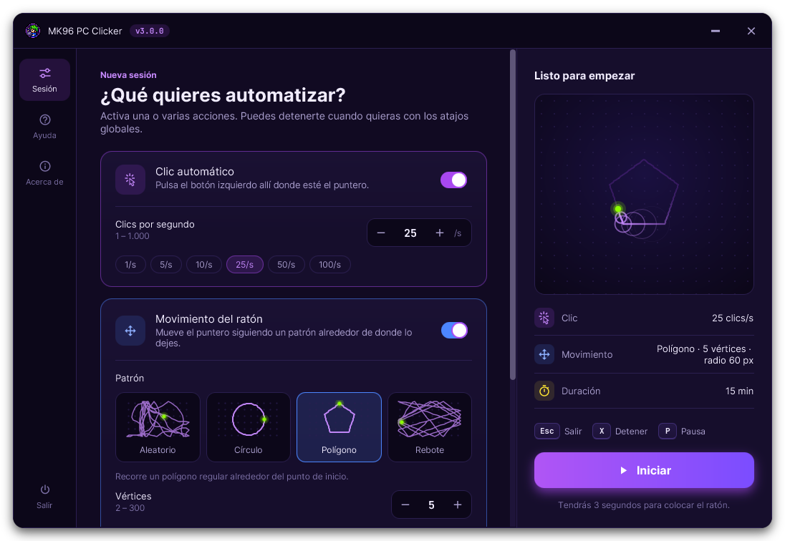
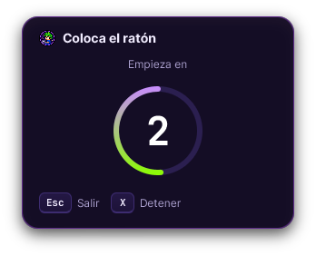
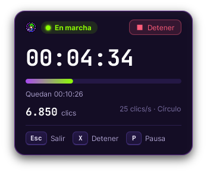
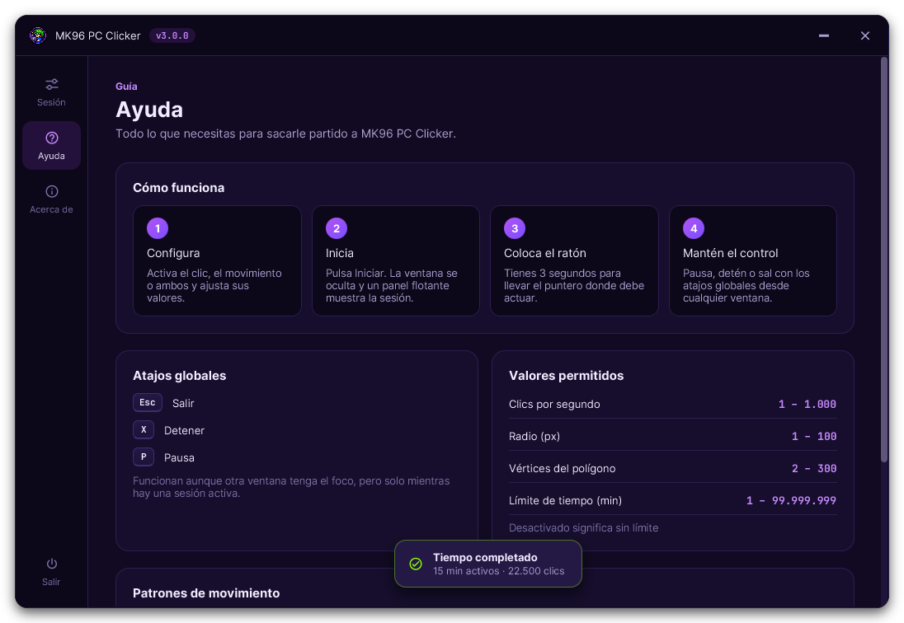

# mk96-app-pc-clicker

**MK96 PC Clicker**: autoclicker de escritorio para Windows hecho en Java 21 con JavaFX. Hace clic de forma automática y puede mover el ratón siguiendo un patrón. Se configura desde una ventana con vista previa en vivo y, durante la sesión, se controla con atajos de teclado globales que funcionan aunque otra ventana tenga el foco.

**[Descargar `mk96-pc-clicker.jar`](https://github.com/mk96-app/mk96-app-pc-clicker/releases/latest/download/mk96-pc-clicker.jar)** (requiere Java 21; ver [Descargar y ejecutar](#descargar-y-ejecutar)).



## Qué hace

Cada capacidad es una tarjeta que se activa con su interruptor. Hay que activar al menos el clic o el movimiento para poder iniciar.

| Tarjeta | Opción | Valores |
|---|---|---|
| **Clic automático** | Clics por segundo (botón izquierdo) | De 1 a 1000. Atajos rápidos: 1, 5, 10, 25, 50 y 100 |
| **Movimiento del ratón** | Patrón | `Aleatorio`, `Círculo`, `Polígono` o `Rebote` |
| | Vértices (solo `Polígono`) | De 2 a 300 |
| | Radio (`Círculo` y `Polígono`) | De 1 a 100 px |
| **Límite de tiempo** | Minutos | De 1 a 99.999.999. Desactivado significa sin límite. Las pausas no cuentan |

Los patrones:

- **Aleatorio**: deambula por la pantalla girando un poco en cada paso y rebota en los bordes.
- **Círculo**: dibuja círculos alrededor del punto donde dejaste el ratón.
- **Polígono**: recorre un polígono regular alrededor de ese punto.
- **Rebote**: avanza en línea recta y rebota en los bordes, con una pequeña desviación en cada rebote.

El panel derecho muestra una **vista previa animada** que usa exactamente las mismas trayectorias que la sesión real, un resumen de la configuración y el botón `Iniciar`.

### Durante la sesión

Al pulsar `Iniciar` la ventana se oculta y aparece un **panel flotante** siempre visible (se puede arrastrar):

1. Una cuenta atrás de 3 segundos para colocar el ratón donde tiene que actuar.
2. Después, el estado en vivo: en marcha o en pausa, tiempo activo, tiempo restante con barra de progreso, clics hechos y configuración.

| Cuenta atrás | En marcha |
|---|---|
|  |  |

Atajos globales, activos solo mientras hay una sesión:

| Tecla | Acción |
|---|---|
| `Esc` | Cierra la aplicación |
| `X` | Detiene la sesión y vuelve a la ventana principal |
| `P` | Pausa o reanuda |

El panel flotante tiene también un botón `Detener`. Al terminar, la ventana principal vuelve con un aviso del resultado (detenida, tiempo completado o error) con el tiempo activo y los clics.

La pestaña **Ayuda** explica el uso, los atajos, los valores permitidos y los patrones; **Acerca de** muestra versión, autor y fecha de compilación. La interfaz está en español o en inglés según el idioma del sistema.



## Descargar y ejecutar

La aplicación se distribuye como un único `.jar` ejecutable que ya incluye JavaFX y todas las dependencias. No hace falta instalar nada más que Java.

1. **Instala Java 21 o superior** si no lo tienes. Por ejemplo, [Eclipse Temurin 21](https://adoptium.net/temurin/releases/?version=21&os=windows) (basta con el JRE). Durante la instalación marca la opción *Associate .jar* para poder abrirlo con doble clic. Para comprobar la versión instalada:

   ```bash
   java -version
   ```

2. **Descarga el ejecutable** [`mk96-pc-clicker.jar`](https://github.com/mk96-app/mk96-app-pc-clicker/releases/latest/download/mk96-pc-clicker.jar) de la última versión. Todas las versiones están en la página de [Releases](https://github.com/mk96-app/mk96-app-pc-clicker/releases).

3. **Ejecútalo** con doble clic sobre el fichero o, desde una terminal en la carpeta donde lo descargaste:

   ```bash
   java -jar mk96-pc-clicker.jar
   ```

Funciona en Windows: el gancho de teclado global usa [`system-hook`](https://github.com/kristian/system-hook). No necesita claves, cuentas ni conexión a internet.

## Compilar desde el código

Requisitos: JDK 21 o superior y Maven 3.9 o superior.

```bash
mvn clean package
java -jar target/mk96-pc-clicker.jar
```

`mvn clean package` genera el mismo `.jar` autocontenido que se publica en Releases. Para desarrollo también vale `mvn javafx:run`.

Los tests (`mvn test`) incluyen las reglas de arquitectura, así que una dependencia entre capas no permitida rompe el build.

## Arquitectura

Arquitectura hexagonal (puertos y adaptadores) escrita con TDD. El núcleo no sabe nada de JavaFX, AWT ni del gancho de teclado, y [ArchUnit](https://www.archunit.org/) lo verifica en cada build (`HexagonalArchitectureTest`).

```
              adaptadores de entrada                       adaptadores de salida
        ┌───────────────────────────────┐            ┌──────────────────────────────┐
        │ ui (JavaFX, MVVM)             │            │ system (AWT Robot, monitores)│
        │ hotkey (gancho global)        │            │ scheduling (ScheduledExecutor)│
        └──────────────┬────────────────┘            └──────────────▲───────────────┘
                       │ port.in (casos de uso)                     │ port.out
                ┌──────▼────────────────────────────────────────────┴──────┐
                │ application: SessionService, HotkeyCommandHandler, ...   │
                │   ┌──────────────────────────────────────────────────┐   │
                │   │ domain: configuración, sesión, movimiento, teclas│   │
                │   └──────────────────────────────────────────────────┘   │
                └──────────────────────────────────────────────────────────┘
                       bootstrap: raíz de composición (único que conoce todo)
```

| Paquete | Responsabilidad |
|---|---|
| `domain.configuration` | Objetos valor con sus rangos (`ClickRate`, `Radius`, `VertexCount`, `TimeLimit`) y `SessionConfiguration`, que exige al menos una acción |
| `domain.geometry` | `ScreenPoint` y `ScreenArea`, sin dependencias de AWT |
| `domain.movement` | Formas (`CircleShape`, `PolygonShape`), trayectorias (`CyclicPath`, `FreeMotionPath`) con política de giro intercambiable (`WanderSteering`, `ReboundSteering`) y `MovementPathFactory` |
| `domain.session` | Agregado `Session` (cuenta atrás → en marcha ⇄ en pausa → terminada) y `Stopwatch`, que descuenta las pausas |
| `domain.control` | `Hotkey`, `Key` y `KeyBindings`: qué tecla dispara cada atajo (preparado para hacerlos configurables) |
| `application.port.in` | Casos de uso: iniciar, detener, pausar, salir, atajos y consulta |
| `application.port.out` | Lo que necesita el núcleo: `MouseDriver`, `ScreenGeometry`, `TaskScheduler`, `SessionEventPublisher` y `ApplicationLifecycle`. Los eventos de sesión son una jerarquía sellada |
| `application.service` | `SessionService` orquesta la sesión con un único cerrojo y tareas ligadas a su sesión. `HotkeyCommandHandler` ignora los atajos si no hay sesión. `ExitApplicationService` cierra de forma ordenada |
| `adapter.in.ui` | JavaFX con MVVM: `ConfigurationViewModel`, `SessionViewModel`, páginas, panel flotante, componentes y tema |
| `adapter.in.hotkey` | Gancho de teclado global que traduce códigos de tecla de Windows a `Hotkey` sin bloquear el hilo nativo |
| `adapter.out.system` | `AwtMouseDriver` (Robot) y `AwtScreenGeometry` (multimonitor) |
| `adapter.out.scheduling` | `ExecutorTaskScheduler` con periodos en nanosegundos e hilos daemon |
| `bootstrap` | `Launcher`, ciclo de vida JavaFX y `ApplicationContext`, que cablea todo a mano |

Decisiones relevantes:

- **El tiempo se inyecta.** `SessionService` recibe un `InstantSource` y un `TaskScheduler`. Los tests usan un `VirtualTimeScheduler` que avanza el tiempo de forma determinista, sin `sleep` ni hilos.
- **La interfaz no duplica reglas.** Los rangos, las teclas y la cuenta atrás que se ven en pantalla salen del dominio o de la configuración. La vista previa y las miniaturas dibujan las trayectorias reales del dominio.
- **Preparada para crecer.** Una nueva capacidad es una `FeatureCard` más; una nueva pantalla es una `Page` más en el raíl de navegación; un nuevo consumidor de eventos (estadísticas, historial…) es otro `SessionEventPublisher`.

## Diseño visual

- Paleta sacada del logo de MK96: noche índigo (`#110A22`), violeta del aro (`#A848F0`), verde neón del pelo (`#8CFC02`), azul de la sudadera (`#4C86FF`) y amarillo de las estrellas (`#FEE532`). Cada tarjeta tiene su color de acento.
- Tema base [AtlantaFX](https://github.com/mkpaz/atlantafx) Primer Dark con sus variables remapeadas a la paleta, para que todos los controles sigan la misma identidad. Estilos en `src/main/resources/com/markes96/pcclicker/ui/css/app.css`.
- Ventana sin marco con esquinas redondeadas, sombra y barra de título propia; iconos [Ikonli](https://kordamp.org/ikonli/) Material Design 2.
- Tipografías Inter (interfaz) y JetBrains Mono (cifras), ambas con licencia SIL Open Font License 1.1 incluida junto a los ficheros.

## Estructura del repositorio

```
.
├── pom.xml
├── docs/images/                         Capturas del README
└── src/
    ├── main/
    │   ├── java/com/markes96/pcclicker/
    │   │   ├── domain/                  Núcleo sin dependencias
    │   │   ├── application/             Casos de uso y puertos
    │   │   ├── adapter/in/ui/           Interfaz JavaFX
    │   │   ├── adapter/in/hotkey/       Atajos globales
    │   │   ├── adapter/out/system/      Ratón y monitores
    │   │   ├── adapter/out/scheduling/  Planificador
    │   │   └── bootstrap/               Arranque y cableado
    │   └── resources/com/markes96/pcclicker/
    │       ├── bootstrap/application.properties   Versión y fecha (filtradas por Maven)
    │       └── ui/                      CSS, textos (es/en), fuentes y logo
    └── test/java/com/markes96/pcclicker/          Tests unitarios, de aplicación y de arquitectura
```
