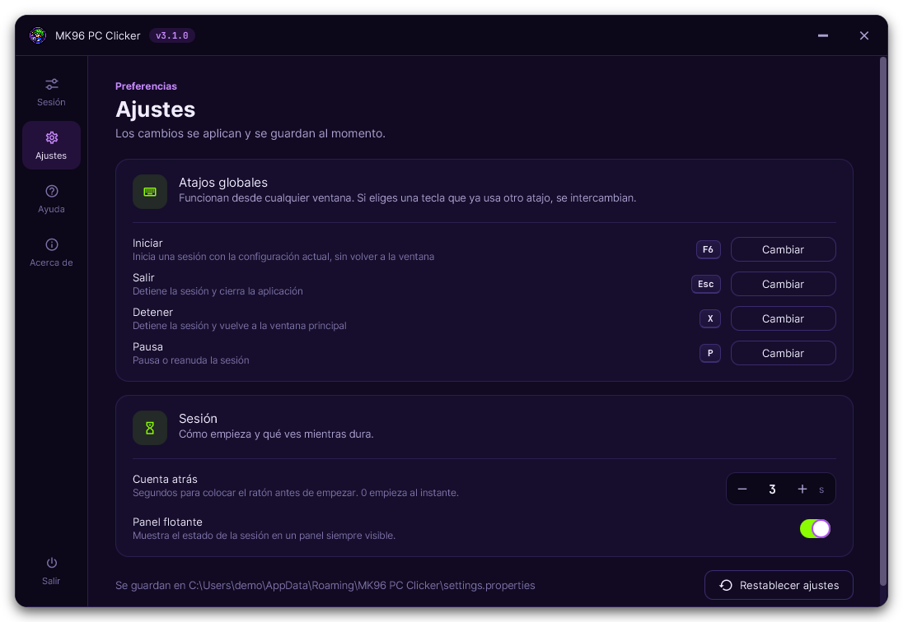

# mk96-app-pc-clicker

**MK96 PC Clicker**: autoclicker de escritorio para Windows hecho en Java 21 con JavaFX. Hace clic de forma automática y puede mover el ratón siguiendo un patrón. Se configura desde una ventana con vista previa en vivo y, durante la sesión, se controla con atajos de teclado globales que funcionan aunque otra ventana tenga el foco.

**[Descargar `mk96-pc-clicker.jar`](https://github.com/mk96-app/mk96-app-pc-clicker/releases/latest/download/mk96-pc-clicker.jar)** (requiere Java 21; ver [Descargar y ejecutar](#descargar-y-ejecutar)).


## Qué hace

Cada capacidad es una tarjeta que se activa con su interruptor. Hay que activar al menos el clic o el movimiento para poder iniciar.

| Tarjeta | Opción | Valores |
|---|---|---|
| **Clic automático** | Clics por segundo | De 1 a 1000. Atajos rápidos: 1, 5, 10, 25, 50 y 100 |
| | Botón | Izquierdo, derecho o central |
| | Tipo de clic | Simple o doble. Un doble clic cuenta como un clic |
| | Variación del ritmo | De 0 a 50 %. Cambia al azar el tiempo entre clics sin alterar el ritmo medio |
| | Detener tras | De 1 a 99.999.999 clics. Desactivado significa sin límite |
| **Movimiento del ratón** | Patrón | `Aleatorio`, `Círculo`, `Polígono` o `Rebote` |
| | Vértices (solo `Polígono`) | De 2 a 300 |
| | Radio (`Círculo` y `Polígono`) | De 1 a 100 px |
| **Límite de tiempo** | Minutos | De 1 a 99.999.999. Desactivado significa sin límite. Las pausas no cuentan |

Los patrones:

- **Aleatorio**: deambula por la pantalla girando un poco en cada paso y rebota en los bordes.
- **Círculo**: dibuja círculos alrededor del punto donde dejaste el ratón.
- **Polígono**: recorre un polígono regular alrededor de ese punto.
- **Rebote**: avanza en línea recta y rebota en los bordes, con una pequeña desviación en cada rebote.

El botón **Limpiar**, arriba a la derecha, apaga todas las acciones, devuelve cada valor al de por defecto y deselecciona el perfil. Pide un segundo clic de confirmación y no toca los perfiles guardados, los favoritos ni los ajustes.

El panel derecho muestra una **vista previa animada** que usa exactamente las mismas trayectorias que la sesión real, un resumen de la configuración y el botón `Iniciar`.

### Perfiles y configuración recordada

- La aplicación **recuerda la última configuración**: al abrirla está todo como lo dejaste.
- La barra **Perfil** carga una configuración completa con un clic. Incluye **perfiles predefinidos**, marcados con un candado, que se pueden usar y guardar como propios, pero no borrar ni modificar:

  | Perfil incluido | Qué hace |
  |---|---|
  | Anti-AFK (círculos) | Mueve el ratón en círculos de 15 px, sin clics |
  | Clic constante · 10/s | 10 clics por segundo, regulares |
  | Clic humano · 7/s | 7 clics por segundo con un 35 % de variación del ritmo |
  | Clic rápido · 50/s | 50 clics por segundo |
  | Doble clic · 1/s | Un doble clic por segundo |
  | Clic derecho · 2/s | 2 clics por segundo con el botón derecho |
  | Farmeo de 1 hora | 12 clics por segundo con un 20 % de variación, durante 60 minutos |

- `Guardar` crea un perfil propio con la configuración actual (por ejemplo, *Farmeo 25 cps*). Si el nombre ya existe, avisa de que lo va a sobrescribir. No se puede usar el nombre de un perfil incluido.
- Los perfiles propios se borran con el botón de la papelera, que pide un segundo clic de confirmación.
- Cualquier perfil, incluido o propio, se marca como **favorito** con la estrella junto al desplegable. Los favoritos aparecen primero en la lista con una estrella amarilla y se recuerdan entre sesiones.
- Si cambias algo después de cargar un perfil, aparece **● Sin guardar** hasta que lo guardes o vuelvas a dejarlo igual.

### Durante la sesión

Al pulsar `Iniciar` (o la tecla de inicio desde cualquier ventana) la ventana se oculta y aparece un **panel flotante** siempre visible que se puede arrastrar:

1. Una cuenta atrás para colocar el ratón donde tiene que actuar: 3 segundos por defecto, configurable de 0 a 10.
2. Después, el estado en vivo: en marcha o en pausa, tiempo activo, tiempo restante con barra de progreso, clics hechos (sobre el límite, si lo hay) y configuración.

| Cuenta atrás | En marcha |
|---|---|
|  |  |

Atajos globales por defecto. Funcionan aunque otra ventana tenga el foco:

| Tecla | Acción | Cuándo |
|---|---|---|
| `F6` | Inicia una sesión con la configuración actual, sin volver a la ventana | Sin sesión activa |
| `Esc` | Detiene la sesión y cierra la aplicación | Durante una sesión |
| `X` | Detiene la sesión y vuelve a la ventana principal | Durante una sesión |
| `P` | Pausa o reanuda | Durante una sesión |

El panel flotante tiene también un botón `Detener`. Al terminar, la ventana principal vuelve con un aviso del resultado (detenida, tiempo completado, clics completados o error) con el tiempo activo y los clics.

### Ajustes

La pestaña **Ajustes** aplica y guarda cada cambio al momento:

- **Atajos globales**: pulsa `Cambiar` y después la tecla nueva (una letra, de `F1` a `F12` o `Esc`). Si la tecla ya la usa otro atajo, los dos se intercambian. Mientras eliges tecla, los atajos globales se desactivan para que no se dispare nada por error.
- **Cuenta atrás**: de 0 a 10 segundos. Con 0 la sesión empieza al instante.
- **Panel flotante**: se puede ocultar. Si los atajos globales no están disponibles, se muestra siempre, porque es la única forma de detener la sesión.
- **Restablecer ajustes** vuelve a los valores por defecto.



La configuración, los perfiles y los ajustes se guardan en `%APPDATA%\MK96 PC Clicker\settings.properties`, un fichero de texto legible. Si se daña o tiene valores no válidos, cada valor afectado vuelve a su valor por defecto sin perder el resto. Para usar otra ubicación (por ejemplo, una copia portable), arranca con `-Dmk96.settingsFile=ruta\al\fichero.properties`.

La pestaña **Ayuda** explica el uso, los atajos, los valores permitidos y los patrones; **Acerca de** muestra versión, autor y fecha de compilación. La interfaz está en español o en inglés según el idioma del sistema.


## Descargar y ejecutar

La aplicación se distribuye como un único `.jar` ejecutable que ya incluye JavaFX y todas las dependencias. No hace falta instalar nada más que Java.

1. **Instala Java 21 o superior** si no lo tienes. Por ejemplo, [Eclipse Temurin 21](https://adoptium.net/temurin/releases/?version=21&os=windows) (basta con el JRE). Durante la instalación marca la opción *Associate .jar* para poder abrirlo con doble clic. Para comprobar la versión instalada:

   ```bash
   java -version
   ```

2. **Descarga el ejecutable** [`mk96-pc-clicker.jar`](https://github.com/mk96-app/mk96-app-pc-clicker/releases/latest/download/mk96-pc-clicker.jar) de la última versión. Todas las versiones están en la página de [Releases](https://github.com/mk96-app/mk96-app-pc-clicker/releases).

3. **Ejecútalo** con doble clic sobre el fichero o, desde una terminal en la carpeta donde lo descargaste:

   ```bash
   java -jar mk96-pc-clicker.jar
   ```

Funciona en Windows: el gancho de teclado global usa [`system-hook`](https://github.com/kristian/system-hook). No necesita claves, cuentas ni conexión a internet.

## Compilar desde el código

Requisitos: JDK 21 o superior y Maven 3.9 o superior.

```bash
mvn clean package
java -jar target/mk96-pc-clicker.jar
```

`mvn clean package` genera el mismo `.jar` autocontenido que se publica en Releases. Para desarrollo también vale `mvn javafx:run`.

Los tests (`mvn test`) incluyen las reglas de arquitectura, así que una dependencia entre capas no permitida rompe el build.

## Arquitectura

Arquitectura hexagonal (puertos y adaptadores) escrita con TDD. El núcleo no sabe nada de JavaFX, AWT ni del gancho de teclado, y [ArchUnit](https://www.archunit.org/) lo verifica en cada build (`HexagonalArchitectureTest`).

```
              adaptadores de entrada                       adaptadores de salida
        ┌───────────────────────────────┐            ┌────────────────────────────────┐
        │ ui (JavaFX, MVVM)             │            │ system (AWT Robot, monitores)  │
        │ hotkey (gancho global)        │            │ scheduling (ScheduledExecutor) │
        │                               │            │ persistence (.properties)      │
        └──────────────┬────────────────┘            └──────────────▲─────────────────┘
                       │ port.in (casos de uso)                     │ port.out
                ┌──────▼────────────────────────────────────────────┴──────┐
                │ application: SessionService, SettingsService, ...        │
                │   ┌──────────────────────────────────────────────────┐   │
                │   │ domain: configuración, sesión, movimiento,       │   │
                │   │         ritmo, teclas, perfiles y preferencias   │   │
                │   └──────────────────────────────────────────────────┘   │
                └──────────────────────────────────────────────────────────┘
                       bootstrap: raíz de composición (único que conoce todo)
```

| Paquete | Responsabilidad |
|---|---|
| `domain.configuration` | Objetos valor con sus rangos (`ClickRate`, `RateVariation`, `ClickLimit`, `Radius`, `VertexCount`, `TimeLimit`), `MouseButton`, `ClickType` y `SessionConfiguration`, que exige al menos una acción |
| `domain.geometry` | `ScreenPoint` y `ScreenArea`, sin dependencias de AWT |
| `domain.movement` | Formas (`CircleShape`, `PolygonShape`), trayectorias (`CyclicPath`, `FreeMotionPath`) con política de giro intercambiable (`WanderSteering`, `ReboundSteering`) y `MovementPathFactory` |
| `domain.timing` | `ClickCadence`: la espera antes de cada clic, exacta o con variación aleatoria que conserva el ritmo medio |
| `domain.session` | Agregado `Session` (cuenta atrás → en marcha ⇄ en pausa → terminada), límites de tiempo y de clics, y `Stopwatch`, que descuenta las pausas |
| `domain.control` | `Hotkey`, `Key` y `KeyBindings`: qué tecla dispara cada atajo; al reasignar una tecla en uso, los atajos se intercambian |
| `domain.settings` | `SessionSettings` (configuración editable, aunque no se pueda iniciar), `Preset` (perfiles incluidos, sin nombre para que cada idioma los nombre), `ProfileLibrary` (perfiles del usuario con nombre único sin distinguir mayúsculas), `Favorites` y `ProfileRef` (favoritos de ambos tipos), `Preferences` y `UserSettings` |
| `application.port.in` | Casos de uso: iniciar, detener, pausar, salir, atajos (y suspenderlos), consulta, configuración actual, perfiles y preferencias |
| `application.port.out` | Lo que necesita el núcleo: `MouseDriver`, `ScreenGeometry`, `TaskScheduler`, `SessionEventPublisher`, `UserSettingsRepository` y `ApplicationLifecycle`. Los eventos de sesión son una jerarquía sellada |
| `application.service` | `SessionService` orquesta la sesión con un único cerrojo y tareas ligadas a su sesión. `HotkeyCommandHandler` resuelve cada tecla con las preferencias vigentes y solo actúa cuando tiene sentido. `SettingsService` guarda perfiles y preferencias al momento y la configuración actual al cerrar. `ExitApplicationService` cierra de forma ordenada |
| `adapter.in.ui` | JavaFX con MVVM: `ConfigurationViewModel`, `ProfilesViewModel`, `PreferencesViewModel`, `SessionViewModel`, páginas, panel flotante, componentes y tema |
| `adapter.in.hotkey` | Gancho de teclado global de bajo nivel que traduce códigos de tecla de Windows a `Key` sin bloquear el hilo nativo |
| `adapter.out.system` | `AwtMouseDriver` (Robot) y `AwtScreenGeometry` (multimonitor) |
| `adapter.out.scheduling` | `ExecutorTaskScheduler` con periodos en nanosegundos e hilos daemon |
| `adapter.out.persistence` | `PropertiesSettingsRepository`: fichero UTF-8 legible, lectura tolerante a valores dañados y escritura atómica |
| `bootstrap` | `Launcher`, ciclo de vida JavaFX y `ApplicationContext`, que cablea todo a mano |

Decisiones relevantes:

- **El tiempo se inyecta.** `SessionService` recibe un `InstantSource` y un `TaskScheduler`. Los tests usan un `VirtualTimeScheduler` que avanza el tiempo de forma determinista, sin `sleep` ni hilos.
- **La interfaz no duplica reglas.** Los rangos, las teclas y la cuenta atrás que se ven en pantalla salen del dominio o de la configuración. La vista previa y las miniaturas dibujan las trayectorias reales del dominio.
- **Preparada para crecer.** Una nueva capacidad es una `FeatureCard` más; una nueva pantalla es una `Page` más en el raíl de navegación; un nuevo consumidor de eventos (estadísticas, historial…) es otro `SessionEventPublisher`.

## Diseño visual

- Paleta sacada del logo de MK96: noche índigo (`#110A22`), violeta del aro (`#A848F0`), verde neón del pelo (`#8CFC02`), azul de la sudadera (`#4C86FF`) y amarillo de las estrellas (`#FEE532`). Cada tarjeta tiene su color de acento.
- Tema base [AtlantaFX](https://github.com/mkpaz/atlantafx) Primer Dark con sus variables remapeadas a la paleta, para que todos los controles sigan la misma identidad. Estilos en `src/main/resources/com/markes96/pcclicker/ui/css/app.css`.
- Ventana sin marco con esquinas redondeadas, sombra y barra de título propia; iconos [Ikonli](https://kordamp.org/ikonli/) Material Design 2.
- Tipografías Inter (interfaz) y JetBrains Mono (cifras), ambas con licencia SIL Open Font License 1.1 incluida junto a los ficheros.

## Estructura del repositorio

```
.
├── pom.xml
├── docs/images/                         Capturas del README
└── src/
    ├── main/
    │   ├── java/com/markes96/pcclicker/
    │   │   ├── domain/                  Núcleo sin dependencias
    │   │   ├── application/             Casos de uso y puertos
    │   │   ├── adapter/in/ui/           Interfaz JavaFX
    │   │   ├── adapter/in/hotkey/       Atajos globales
    │   │   ├── adapter/out/system/      Ratón y monitores
    │   │   ├── adapter/out/scheduling/  Planificador
    │   │   ├── adapter/out/persistence/ Ajustes y perfiles en disco
    │   │   └── bootstrap/               Arranque y cableado
    │   └── resources/com/markes96/pcclicker/
    │       ├── bootstrap/application.properties   Versión y fecha (filtradas por Maven)
    │       └── ui/                      CSS, textos (es/en), fuentes y logo
    └── test/java/com/markes96/pcclicker/          Tests unitarios, de aplicación y de arquitectura
```
